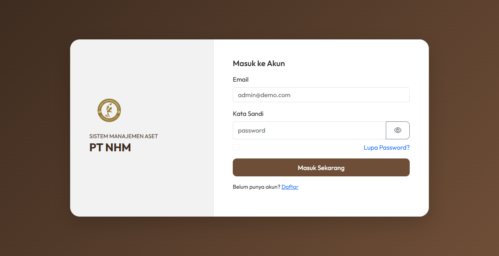
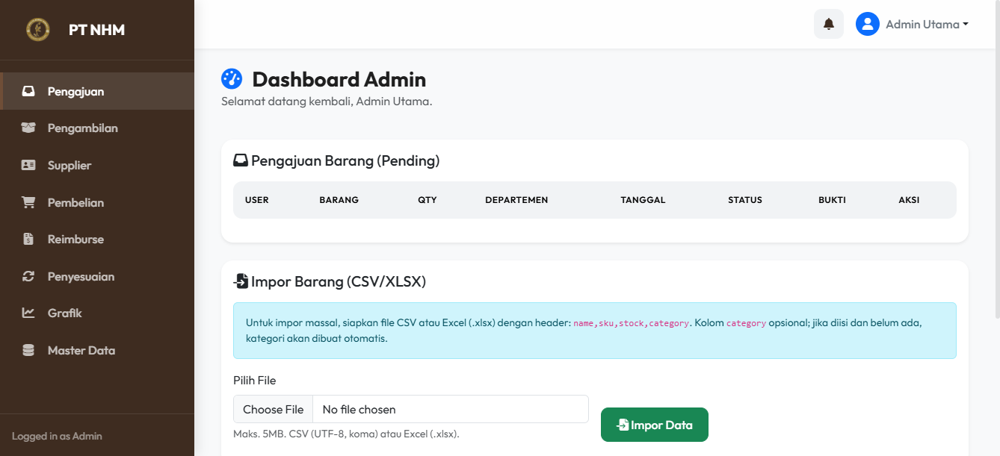
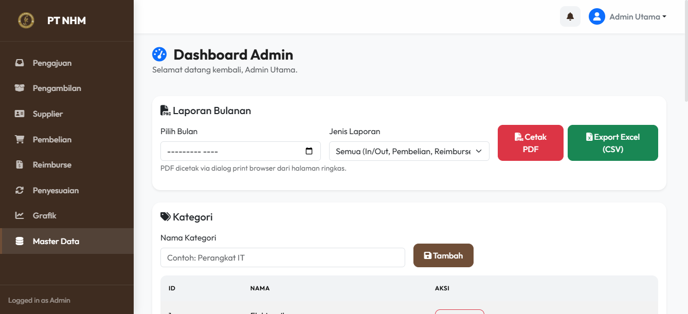

# Enterprise Asset Management (EAM) System

Enterprise asset and inventory management system with a PHP/PostgreSQL backend, Progressive Web App (PWA) capabilities, and a dedicated Flutter Android companion app with barcode scanner integration.

Designed to manage procurement workflows, multi-department asset requisition, stock movements, depreciation, and supplier tracking.

---

## Preview

### Login & Authentication


### Admin Dashboard (Requisition & Bulk Import)


### Master Data & Monthly Reporting


---

## Key Features

- **Role-Based Access Control (RBAC):**
  - **Admin Utama:** Full control over approvals, master data, user permissions, and audit reports.
  - **Admin Stok:** Stock movement logging, warehouse intake, and inventory audits.
  - **Atasan (Management):** Budget review, requisition approvals, and expenditure reports.
  - **User (Staff):** Item requisitions, procurement submissions, and reimbursement requests.
- **Workflow & Requisition Engine:** End-to-end procurement and reimbursement tracking with invoice and receipt image uploads.
- **Mass Import & Export:** Bulk import for items and stock via CSV/XLSX; export financial and audit summaries to PDF and CSV.
- **Progressive Web App (PWA):** Offline shell caching with `sw.js` (Network-First for dynamic PHP APIs, Cache-First for static assets) and `manifest.json`.
- **Flutter Android Companion App (`android_mobile`):** Native Android wrapper powered by Flutter, enabling hardware integration such as camera barcode scanning for physical asset audits.
- **Database Engine:** Built for PostgreSQL 14+ / Supabase Connection Pooler (PgBouncer port `6543`), supporting transactional integrity via PDO and sequence-driven ID tracking.

---

## Tech Stack

- **Backend / Web:** PHP 8+, Vanilla Modern JavaScript (ES6+), Bootstrap 5, FontAwesome
- **Database:** PostgreSQL (compatible with local PostgreSQL or cloud Supabase)
- **Mobile Client:** Flutter, Dart, WebView Flutter (`android_mobile/`)
- **PWA Infrastructure:** Service Worker Cache API, Web App Manifest
- **Security:** Bcrypt password hashing, session hardening, strictly bound PDO prepared statements

---

## Directory Structure

```text
.
├── android_mobile/     # Flutter mobile application
├── docs/               # Architecture diagrams and UI preview screenshots
├── img/                # Branding assets and system logos
├── includes/           # Centralized database helpers, auth guards, config loaders
│   ├── auth.php
│   ├── config.php
│   └── db.php
├── public/             # Web root (dashboards, handlers, assets, PWA manifest & worker)
│   ├── assets/         # Styles and UI scripts
│   ├── handlers/       # Request processors (login, purchase, requests)
│   ├── uploads/        # Uploaded receipts and document attachments
│   ├── dashboard_*.php # Role-specific dashboard views
│   ├── index.php       # Authentication gateway
│   ├── manifest.json   # PWA manifest
│   └── sw.js           # PWA service worker
├── assetmanagement.sql # Database schema (MySQL reference)
├── assetmanagement_pg.sql # PostgreSQL schema & seed definitions
├── SUPABASE_SETUP.md   # Setup guide for cloud Supabase database
└── .env.example        # Environment variable configuration template
```

---

## Installation & Setup

### 1. Database Setup
Create a PostgreSQL database (locally or on Supabase) and import the schema:
```bash
psql -U postgres -d assetmanagement -f assetmanagement_pg.sql
```

### 2. Environment Configuration
Copy `.env.example` to `.env` in the project root:
```ini
DB_HOST=localhost
DB_PORT=5432
DB_USER=postgres
DB_PASS=your_password
DB_NAME=assetmanagement
DEV_MODE=false
```

### 3. Running the Web Platform
Serve the `public/` directory via Apache, Nginx, or the built-in PHP server:
```bash
php -S 127.0.0.1:8080 -t public
```

### 4. Running the Flutter Companion App
Navigate to `android_mobile/` and run:
```bash
flutter pub get
flutter run
```

---

## License

This project is released under the [MIT License](LICENSE).
